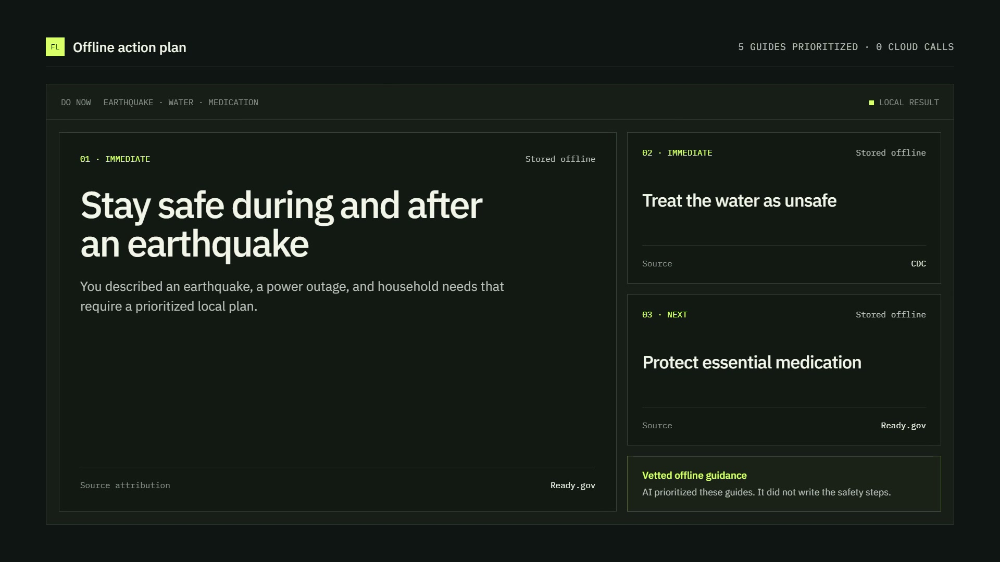
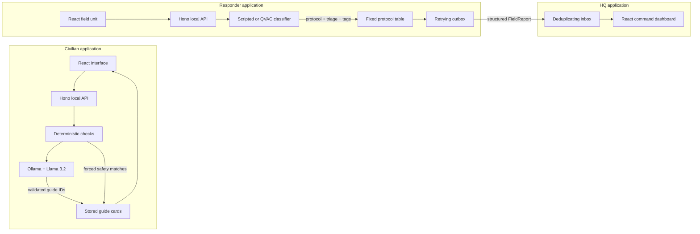

# FieldLink

**Offline-first disaster guidance that keeps local AI behind a deterministic safety boundary.**

[](media/fieldlink-demo.mp4)

▶ **[Watch the 20-second product demo](media/fieldlink-demo.mp4)**

FieldLink was built at HackMIT 2026 to explore a practical question: what can useful software still do when disaster infrastructure and cloud access fails? The system combines local classification with stored, source-attributed guidance for civilians, field responders, and command teams.

> FieldLink is a hackathon prototype for educational demonstration. It is not a medical device and does not replace emergency services or qualified professional guidance.

## What it does

FieldLink provides two connected experiences:

- **Civilian guidance:** a private local assistant turns a situation description and household needs into prioritized offline guide cards.
- **Responder relay:** a field unit classifies a compact situation report, loads instructions from a fixed protocol table, and relays a structured payload to an HQ dashboard.

The important boundary is deliberate: models select structured identifiers; they do not author the safety steps shown to users.

## Key features

- Runs the civilian planning flow locally through Ollama and Meta Llama 3.2.
- Applies deterministic overrides for immediately dangerous phrases before assembling a plan.
- Restricts model output to known guide IDs and validated structured fields.
- Loads displayed actions from stored guide cards attributed to CDC, Ready.gov, FDA, and the American Red Cross.
- Supports local browser voice capture and on-device speech transcription.
- Relays Zod-validated field reports through retrying, deduplicating transport.
- Restricts responder egress to loopback or Thunderbolt link-local addresses.
- Aggregates received reports by triage level in the HQ dashboard.
- Includes unit, UI, evaluation, offline-guard, and end-to-end tests.

## Architecture



## Technology

| Area | Technologies |
| --- | --- |
| Frontend | React 19, TypeScript, Vite |
| Local APIs | Hono, `@hono/node-server` |
| AI and speech | Ollama, Meta Llama 3.2, QVAC, Transformers.js, Whisper Tiny |
| Validation | Zod, JSON Schema |
| Testing | Vitest, Testing Library, jsdom |
| Tooling | ESLint, TypeScript, npm workspaces, Husky |

## Safety-oriented design

FieldLink separates probabilistic classification from deterministic action text:

1. The input is checked for explicit danger patterns and supported scenario candidates.
2. A local model ranks only known guide or protocol identifiers.
3. The response is validated and filtered against those candidates.
4. Displayed actions are loaded from a stored protocol or guide table.
5. Unsupported responder situations escalate instead of producing improvised instructions.

This architecture reduces—but does not eliminate—the risks of using a language model in a safety-sensitive prototype.

## My contributions

- Built the initial civilian application: local API, planning pipeline, guide catalog, React interface, tests, and setup documentation.
- Integrated local Ollama inference and conversational-intent handling.
- Added browser voice capture, local transcription, model prefetching, and fallback handling.
- Implemented deterministic safety routing, structured diagnostics, request trace IDs, and degraded-response behavior.
- Developed the guided conversation flow and major civilian/responder interface updates.
- Improved responder Whisper startup and clean-install behavior for optional local-model tooling.

FieldLink was a collaborative hackathon project. These bullets describe work supported by commit history; they do not imply sole authorship of the system.

## Getting started

### Requirements

- Node.js 22.17 or newer
- npm 10 or newer
- Ollama for the real civilian local-model path

### Install

```bash
git clone https://github.com/yashvasdev/fieldlink.git
cd fieldlink
npm ci
```

### Run the civilian application with local Llama

Download the model once while online:

```bash
ollama pull llama3.2:1b-instruct-q4_K_M
```

PowerShell:

```powershell
$env:CIVILIAN_ENGINE="ollama"
npm run dev:civilian
```

macOS or Linux:

```bash
CIVILIAN_ENGINE=ollama npm run dev:civilian
```

Open <http://127.0.0.1:3002> and wait for **Local AI ready**.

For UI development without Ollama, use the explicit scripted fallback. Do not present this mode as a live Llama run.

```powershell
$env:CIVILIAN_ENGINE="scripted"
npm run dev:civilian
```

### Run responder and HQ

Start HQ:

```bash
npm run dev:hq
```

In a second terminal, start the demo-safe responder engine:

```powershell
$env:ENGINE="scripted"
$env:NET_PROFILE="clean"
npm run dev:responder
```

- Responder: <http://127.0.0.1:3000>
- HQ: <http://127.0.0.1:3001>

The QVAC path requires its local weights and runtime to be prefetched before going offline:

```bash
npm run models:prefetch
```

Then run with `ENGINE=qvac` using the environment-variable syntax for your shell.

## Verification

```bash
npm run lint
npm run typecheck
ENGINE=scripted npm test
```

PowerShell equivalent:

```powershell
npm run lint
npm run typecheck
$env:ENGINE="scripted"
npm test
```

The real QVAC evaluation is opt-in:

```bash
EVAL_ENGINE=qvac npm run test:qvac
```

## Known limitations

- This is a hackathon prototype, not production emergency software.
- HQ reports and transport deduplication are stored in memory.
- The physical Thunderbolt workflow and real QVAC inference require compatible hardware and local model assets.
- Communications-savings figures in the dashboard are estimates based on fixed assumptions, not field measurements.
- Stored safety content requires qualified review and an update process before real-world deployment.

## Team and attribution

FieldLink was developed collaboratively at **HackMIT 2026** by:

- [Yash Vasdev](https://github.com/yashvasdev)
- [Ramika De Silva](https://github.com/RamikaDeSilva)
- [Jagathi Moturi](https://github.com/jagathimoturi)

This portfolio fork preserves the original Git history and contributors. The upstream team repository is [RamikaDeSilva/fieldlink](https://github.com/RamikaDeSilva/fieldlink).

## License status

The upstream repository does not currently declare a software license. The repository remains subject to the rights and permissions of its contributors; contact the team before redistributing or reusing the code outside GitHub's fork functionality.
